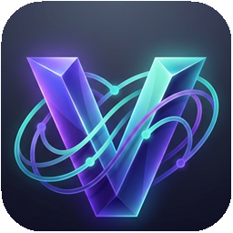
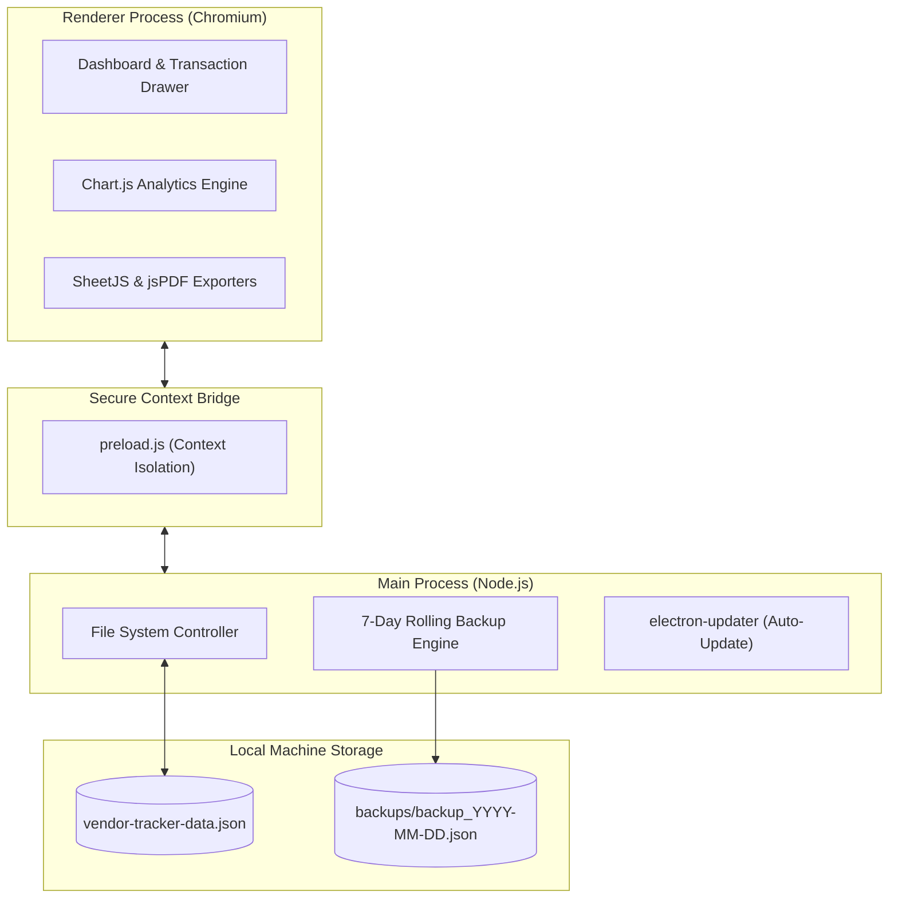

<div align="center">



# Ventrack

### High-Performance Offline-First Vendor & Order Management System for Windows

**100% Local Storage · Air-Gapped Privacy · Automated 7-Day Rolling Backups · Zero Cloud Dependencies**

<br />

<a href="https://github.com/Talha-Quraishi/Ventrack/releases/latest">
  
</a>

<br /><br />

[](https://github.com/Talha-Quraishi/Ventrack/releases/latest)
[](#installation--setup)
[](https://opensource.org/licenses/MIT)
[](#security--offline-first-storage)
[](#tech-stack)
[](#studio-grade-ui--themes)

</div>

---

## 🚀 Quick Download & Installation

You can get started immediately with the pre-compiled Windows installer:

1. **Download the Installer**: Grab the latest [`Ventrack-20.17.21.exe`](https://github.com/Talha-Quraishi/Ventrack/releases/latest) from the Releases page.
2. **Run Setup**: Follow the clean NSIS wizard to select your destination directory and create desktop shortcuts.
3. **Launch & Manage**: Launch **Ventrack** and start tracking vendor orders, ledger balances, and payment milestones immediately—no account, login, or internet required.

---

## 🌟 Why Ventrack?

Most vendor management tools are bloated, expensive SaaS platforms requiring monthly subscriptions, persistent internet connections, and vendor lock-in. **Ventrack** was engineered from the ground up for independent businesses, operations managers, and procurement teams who demand:

- **Complete Data Sovereignty**: All vendor ledgers, records, and financial balances remain strictly on your physical machine.
- **Instantaneous UI**: Native Electron architecture with zero network latency, instant searching, and sub-millisecond filtering.
- **Battle-Tested Reliability**: Automated rolling daily backups with a 7-day retention engine protect you against accidental data corruption or hardware hiccups.

---

## ⚡ Key Features

### 📊 Real-Time Vendor & Order Dashboard
- **Live KPI Overview**: Instant metrics for Pending Orders, Cleared Invoices, Total Outstandings, and Active Vendors.
- **Deep-Search & Multi-Filter**: Filter orders across payment statuses (*Pending*, *In Progress*, *Completed*, *Disputed*), date windows, and party names in real-time.
- **Transaction Drawer**: Seamless slide-out panel for fast record entry, line-item itemization, notes, and payment status updates.

### 📈 Built-in Visual Analytics
- **Dynamic Cash Flow Visualizer**: Interactive charts powered by Chart.js displaying historical payment trends and monthly commitments.
- **Vendor Concentration Breakdown**: Visual distribution of outstanding liabilities per vendor to manage supplier risk.

### 📑 One-Click Professional Exports
- **Excel Spreadsheets (`.xlsx`)**: Client-ready structured workbooks generated natively using SheetJS without requiring Microsoft Office installed.
- **Formatted PDF Statements**: Clean, printable invoices and transaction reports rendered directly via jsPDF and AutoTable.

### 🛡️ Automated 7-Day Rolling Backups
- **Zero-Friction Snapshots**: Ventrack automatically snapshots your entire database upon daily launch (`backup_YYYY-MM-DD.json`).
- **Auto-Rotation**: Preserves a strict 7-day rolling window to optimize disk space while ensuring foolproof point-in-time recovery.
- **1-Click Manual Backup & Restore**: Export your database or restore from past snapshots at any time with native Windows dialogs.

### 🎨 Studio-Grade UI & Themes
- **Adaptive Light & Dark Modes**: Hand-tuned dark and light palettes built with Tailwind CSS.
- **Custom Accent Themes**: Personalize your workspace with curated brand color accents.
- **Responsive Layout**: Designed for high-DPI displays with crisp typography using Inter and Outfit.

---

## 🏗️ Technical Architecture

Ventrack leverages Electron's isolated architecture to provide native OS capabilities while keeping the presentation layer secure and responsive:



---

## 🔒 Security & Offline-First Storage

| Property | Guarantee |
| :--- | :--- |
| **Network Requests** | **Zero Telemetry**. Ventrack operates completely air-gapped without external telemetry or tracking. |
| **Data Location** | Windows AppData (`%APPDATA%/ventrack/vendor-tracker-data.json`). |
| **Backups** | Timestamped JSON snapshots stored in `%APPDATA%/ventrack/backups/`. |
| **Isolation** | Context isolation enabled with locked down web preferences. |

---

## 💻 Local Development & Building

If you would like to run or compile Ventrack from source:

### Prerequisites
- [Node.js](https://nodejs.org/) (v18 or higher recommended)
- [npm](https://www.npmjs.com/)

### 1. Clone the Repository
```bash
git clone https://github.com/Talha-Quraishi/Ventrack.git
cd Ventrack
```

### 2. Install Dependencies
```bash
npm install
```

### 3. Run in Development Mode
```bash
npm start
```

### 4. Package for Windows
```bash
# Generate unpacked Windows executable for testing
npm run pack

# Build complete NSIS installer (.exe) in the dist/ folder
npm run dist
```

---

## 🛠️ Tech Stack

- **Runtime & Window Management**: [Electron](https://www.electronjs.org/) (v28)
- **Styling & Design System**: [Tailwind CSS](https://tailwindcss.com/)
- **Icons**: [Lucide Icons](https://lucide.dev/)
- **Data Visualization**: [Chart.js](https://www.chartjs.org/)
- **Spreadsheet Generation**: [SheetJS (xlsx)](https://sheetjs.com/)
- **Document Generation**: [jsPDF](https://github.com/parallax/jsPDF) & [AutoTable](https://github.com/simonbengtsson/jsPDF-AutoTable)
- **Packaging & Distribution**: [electron-builder](https://www.electron.build/) with NSIS target

---

## 📄 License

This project is open-source and released under the **[MIT License](LICENSE)**.

---

<div align="center">

Crafted with care by **[Talha-Quraishi](https://github.com/Talha-Quraishi)**

</div>
